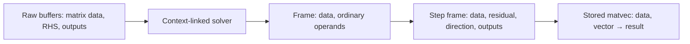

# Explicit context operands through implementation linking

Stored operators receive their data as declared operands. A CG or Lanczos operation call
that originally receives only a vector cannot read a stored matrix through an undeclared
global handle. Context linking adds the data operands to the fixed program tree and forwards
them through every procedure frame.

For `c` context operands, the context handles occupy the first `c` buffer variables. Their
offsets occupy a contiguous block inserted at index slot `j`. Ordinary buffer variables shift
by `c`; ordinary index variables at or after `j` also shift by `c`. A procedure frame retains
its dimensions and prepends the context to its operand list, so its child uses
`j = dimensions.length`. Allocations and index binders continue to append their variables.



A fixed context table gives each source operation either an ordinary renamed target operation
or an implementation with the extra context inputs. Its implementations are ordinary `Impl`
trees, with no whole-algorithm callback. The CG matvec implementation has dimensions `[m,n]`, receives `(data,x) → y`,
and invokes the scalar dense implementation on those declared operands. PCG forwards two data operands;
its system application selects the first and its inverse-preconditioner application selects
the second. Unchanged scalar and BLAS primitives receive their ordinary operands.

The reusable interfaces are:

```lean
ContextTable Op Lo Tst := Op → Impl Lo Tst ⊕ Lo
Stmt.linkContext (count slot : ℕ) (table : ContextTable Op Lo Tst) :
  Stmt Op Tst → Stmt Lo Tst
```

An implemented call checks the implementation arities against the original dimension count,
the original inputs plus `count`, and the original outputs. Its frame explicitly receives the
context operands before the original operands. Ordinary frames prepend the same context and
recursively translate their body. The transform is fixed before sizes, words and samples are
supplied; invalid arities produce the ordinary failing statement.

The semantic bridge uses a forward simulation of successful source steps under a read-only
context invariant. Its assumptions concern individual primitive calls and queries, together
with ordinary local framing; no execution theorem is accepted as a primitive model premise.
The initial source environment contains the actual vector/output handles and excludes the
context buffer handles. Every context handle is live. Allocation therefore preserves this
separation automatically, and no source primitive can write a context buffer through its
ordinary output operands. The first stored interfaces use distinct raw buffers, so this
buffer separation is supplied by their input layout.

The proof constructs a guarded source interpretation. While the stored input snapshot is
preserved and ordinary outputs avoid its protected prefix, a call checks the source local
contract precondition and delegates to the context-linked implementation. Outside that regime,
a jointly valid reference interpretation supplies the same source contracts. These guards and
the reference interpretation exist only in the proof. No guard, host matrix decoder or hidden
matrix callback is substituted for instructions in the executed target tree.

`ContextDense.wp_source` discharges the local dense obligation from the actual raw matrix
read, scalar arithmetic laws, live context operands and output separation. The original total
solver proof supplies success under the guarded source laws. A generic snapshot simulation
then transfers that successful execution to the actual context-linked interpreter. Thus the
public theorem retains ordinary input and primitive assumptions, without asking the caller
to assume a successful solver run or an arbitrary whole-program simulation.

The final canonical certificate instruments the translated tree itself. Additional context
operand evaluation, frame entry and primitive implementation instructions remain in its full
count/work/span manifest. Supplied matrix/preconditioner buffers count as resident payload.
Forwarding alone allocates no stored words; primitive and linked-kernel workspace still comes
from their declared resource model and checked implementation tables. Stored CG, PCG, ordinary
Lanczos and reorthogonalized Lanczos reuse their numerical word proofs through this bridge.
